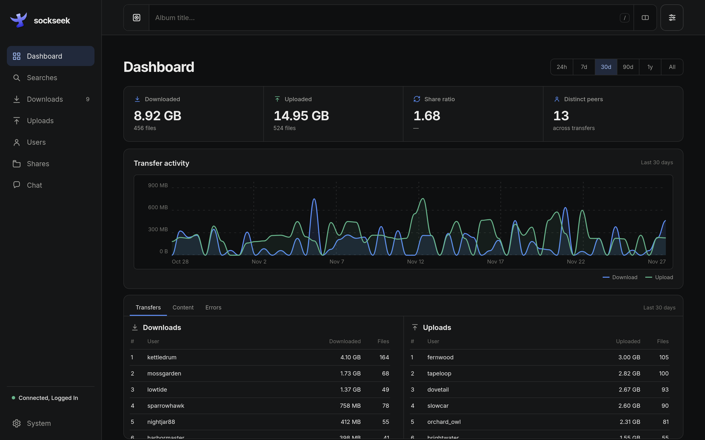
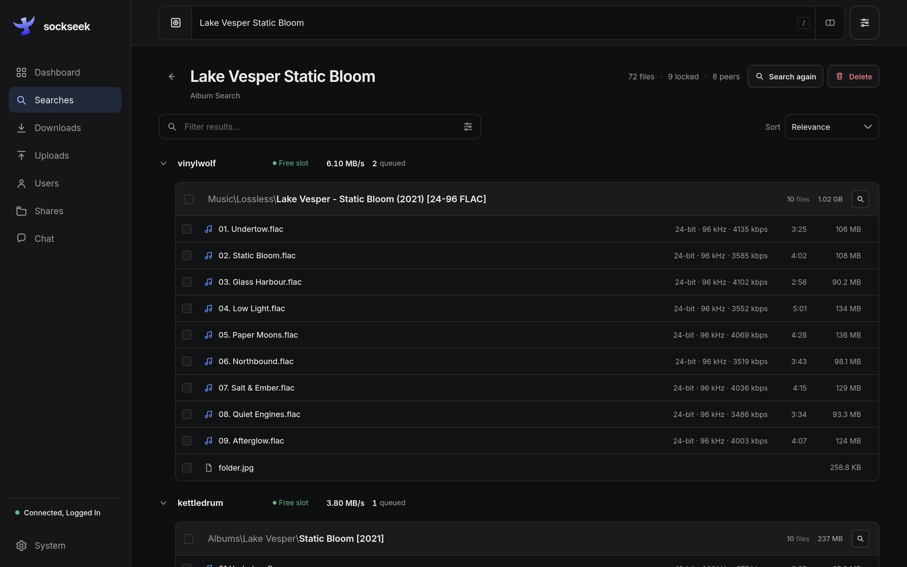
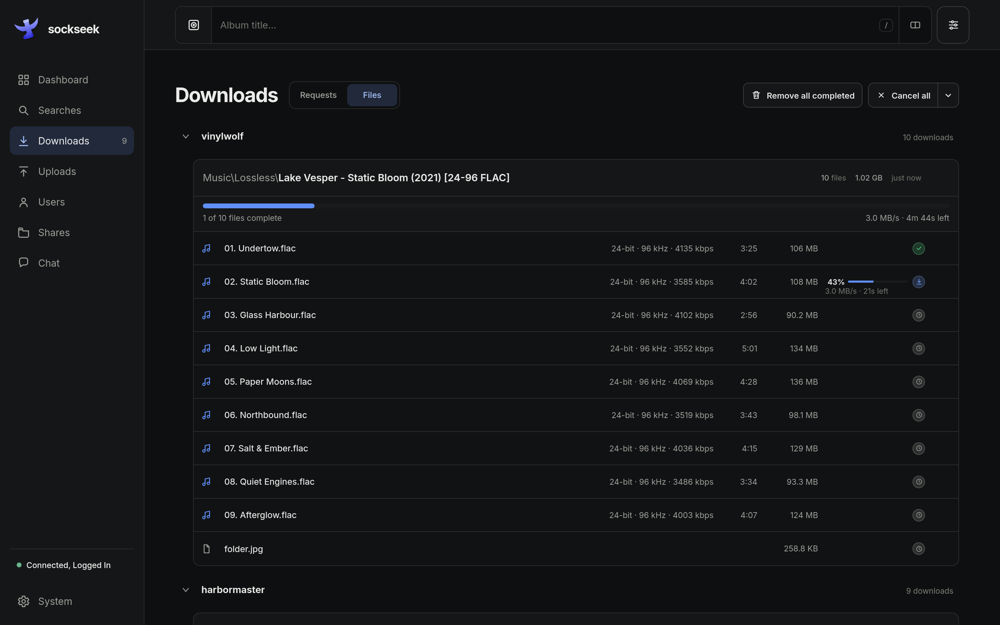
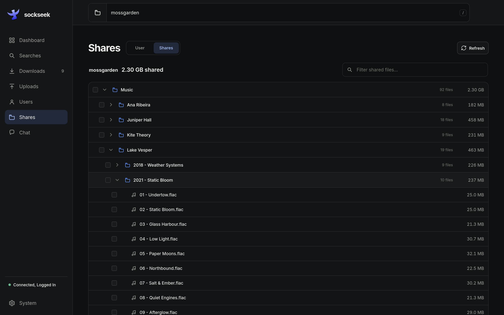

# Sockseek

Sockseek is a self-hosted Soulseek client. Run the daemon to search, download, share files and chat from the WebUI. Give it an artist and album, a playlist, or a CSV file and it can also rank the available files against your preferences and download the best matches automatically.



<table>
  <tr>
    <td></td>
    <td></td>
    <td></td>
  </tr>
</table>

> [!NOTE]
> This branch is the 4.0 beta. Its manual is published at [fiso64.github.io/sockseek](https://fiso64.github.io/sockseek/).
> For the released 3.x version, see the [3.x README](https://github.com/fiso64/sockseek/blob/v3.1.0/README.md). [Coming from 3.x](docs/pages/using-sockseek/coming-from-v3.md) lists what changed.

## Getting started

The [getting started guide](docs/pages/index.md) covers both the daemon and the local CLI.

The manual for your installed version is also available at `/docs/` on your daemon, with built-in search.

## Desktop UI

Want a desktop client, or a graphical interface for the download tool? Run this in a terminal on your own computer and open the WebUI in your browser:

```sh
sockseek daemon --no-auth
```

The [desktop UI section](docs/pages/index.md#desktop-ui) has the steps. Sockseek will soon be packaged as a proper desktop app.

## One-shot downloads

You can run individual or bulk downloads without a running daemon. Configure your Soulseek credentials and run:

```sh
sockseek "Artist - Album Title" -t
```

See [one-shot downloads](docs/pages/using-sockseek/one-shot.md), [configuration](docs/pages/using-sockseek/configuration.md), or the [CLI options](docs/pages/reference/options.md). Run `sockseek --help` for terminal help.

## About the name

This project started as `slsk-batchdl`, which was a mouthful. It became `sldl`, which implies a download utility, and it is now a full Soulseek client. So it is called Sockseek, because I don't know how to name things.

## Acknowledgments

- [Soulseek.NET](https://github.com/jpdillingham/Soulseek.NET), the Soulseek protocol library Sockseek is built on.
- [slskd](https://github.com/slskd/slskd), for UI inspiration.
- [Nicotine+](https://github.com/nicotine-plus/nicotine-plus) and slskd, as references for backend behaviour and protocol correctness.
