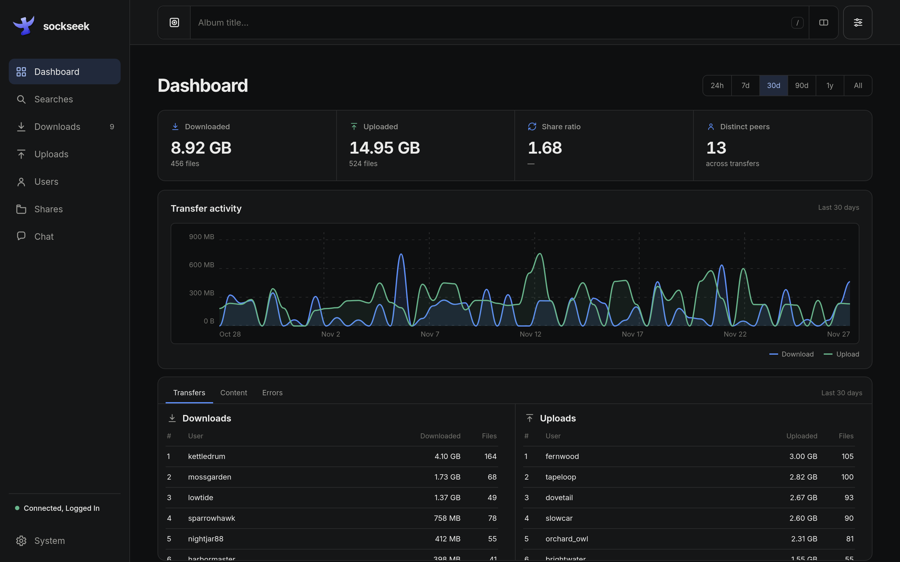

# Getting started

Sockseek can run for a single download on your computer or stay connected as a daemon. Both can download albums, tracks, and playlists.

## Soulseek Client

The background daemon is a full Soulseek client and includes a WebUI. You can search in the browser, queue downloads, share a library, and receive messages. You can also submit jobs from the [remote CLI](./using-sockseek/daemon.md#remote-cli).

Choose your install option:

- [Release archive](./installation/release-archive.md), then [start the daemon](./using-sockseek/daemon.md#start-the-daemon).
- [Debian package](./installation/debian.md)
- [NixOS](./installation/nixos.md)
- [Docker Compose](./installation/docker.md)

Once signed in, try [your first WebUI search or download](./using-sockseek/daemon.md#your-first-webui-search-or-download).

## Desktop UI

If you want a desktop Soulseek client, or a graphical interface for the Sockseek download tool, you can have one today. Run the daemon on your own computer and use the WebUI in your browser:

1. [Install the release archive](./installation/release-archive.md).
2. Run `sockseek daemon --no-auth` in a terminal and leave it open.
3. Open [http://127.0.0.1:5030](http://127.0.0.1:5030).

`--no-auth` skips the WebUI sign-in. That suits a desktop because the daemon only accepts connections from your own computer by default. If you set `server-ip` to make it reachable from other devices, [set a password](./using-sockseek/daemon.md#start-the-daemon) and drop `--no-auth`.

The daemon runs for as long as the terminal stays open. Everything the download tool does, including playlist, CSV and album downloads, is available from **New job** in the WebUI.

Sockseek will soon be packaged as a proper desktop app, so this will not need a terminal.

## Local CLI (one-shot downloading)

Use the local CLI to download from a terminal or script. It connects to Soulseek, saves the files on your computer, and exits when the job finishes.

[Install from a release archive](./installation/release-archive.md) and set your Soulseek credentials. Then continue to [one-shot downloads](./using-sockseek/one-shot.md) for basic usage and examples.
