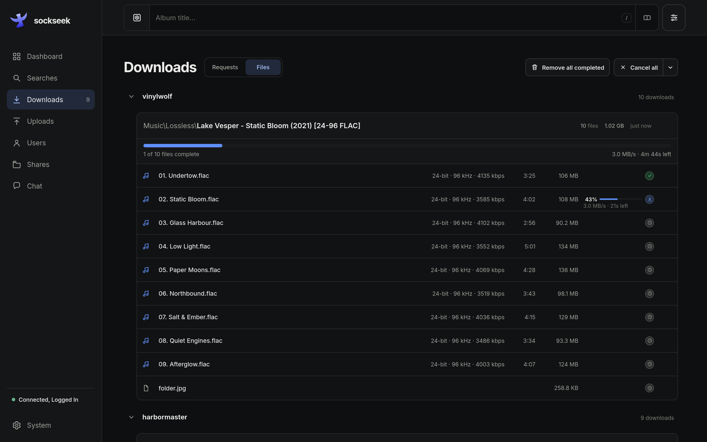

<!-- sockseek-help:start(daemon) -->
# Daemon and remote access

The daemon serves the WebUI and the HTTP API. It listens on `127.0.0.1:5030` by default. To listen on another interface, set `server-ip` to its address. The Soulseek peer listener uses a separate `listen-port`.

## Start the daemon

If you installed the [release archive](../installation/release-archive.md), run `sockseek auth hash-password` and enter the password you want to use for the WebUI. Add the printed hash to your `sockseek.conf`:

```ini
web-password-hash = paste-the-hash-here
```

Start the daemon on your computer:

```sh
sockseek daemon --allow-http-auth
```

Open [http://127.0.0.1:5030](http://127.0.0.1:5030) and sign in as `admin` with your WebUI password.

## Your first WebUI search or download

Use the main search bar to inspect results and choose the files or folder you want. The search bar has several modes, which can be chosen with the button on the left. For an album, try `Artist - Album Title`. Group modes combine same songs or albums into groups so you can view an artist's discography in the search results.  See more info about [download modes](../downloading/download-modes.md). 

For an automatic download, create a download job in **Searches → New Job**. Sockseek can take a search string, a playlist, a CSV, or a list and pick matches using your [file conditions](../downloading/ranking-and-filtering.md). Filter conditions decide which results qualify. Ranking conditions help choose among the qualifying results. See [download modes](../downloading/download-modes.md) and [supported inputs](../downloading/auto-downloads.md) for examples.



## Share a folder

Add a directory on the daemon machine to your config, for example `share = /path/to/Music`. Use **System → Rescan shares** to update the catalog, then check **System → Shares** to see what peers can browse. See the [sharing and upload options](../reference/daemon-options.md#sharing-uploads-and-chat).

## Ports and connectivity

The daemon uses two ports:

- **5030, the WebUI and API.** It accepts connections from the same computer only. To reach it from other devices, set `server-ip` to the address to listen on, and put it behind HTTPS: sign-in over plain HTTP is refused unless you set `allow-http-auth`. See [WebUI and access options](../reference/daemon-options.md#webui-and-access).
- **49998/TCP, the Soulseek peer listener** (`listen-port`). Other Soulseek users connect to it to download from you and to send you files. Sockseek works without it being reachable, but transfers with peers who are also unreachable will fail. If you are behind a router, forward this port to the machine running the daemon, and allow it through that machine's firewall.

## Remote CLI

Create a named API key in **System → API**. Copy the secret when it is shown and save it in a file on the client machine. You can now submit downloads from the CLI:

```sh
sockseek "Artist - Album Title" --remote https://your-daemon --remote-api-key-file /path/to/key
```

Use `--detach` to print the workflow ID and exit, or `--monitor` to watch active workflows. Files are downloaded to the daemon's output directory. The same connection options work with commands such as `sockseek chat conversations` and `sockseek transfers`. Put `remote` and `remote-api-key-file` in a [configuration profile](./configuration.md#configuration-profiles) if you also use the CLI for local downloads.

For key management, offline maintenance, and sharing options, see the [daemon reference](../reference/daemon-options.md).
<!-- sockseek-help:end -->
